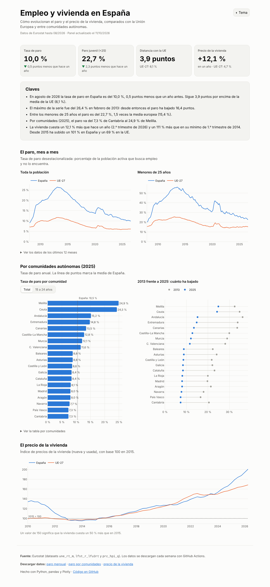
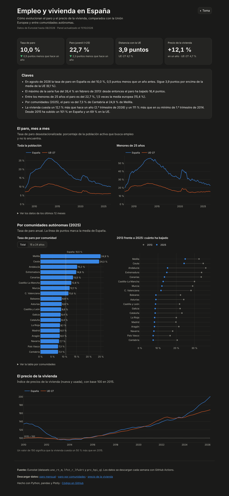
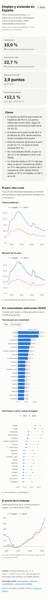
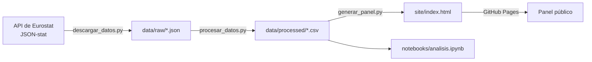

# 📊 Empleo y vivienda en España

Panel interactivo sobre la evolución del **paro** (general y juvenil, España frente a la UE y por comunidades autónomas) y del **precio de la vivienda**. Usa datos abiertos de **Eurostat** que se descargan y publican solos cada semana.

**🔗 Panel en vivo:** https://munguiagomezj.github.io/Proyecto3/ · **📓 Análisis:** [notebooks/analisis.ipynb](notebooks/analisis.ipynb)



<details>
<summary>Ver modo oscuro y versión móvil</summary>

| Modo oscuro | Móvil |
|---|---|
|  |  |

</details>

## 🔎 Qué muestra

- **Indicadores clave** y un resumen en frases que se **calcula a partir de los datos**: si cambian los datos, cambia el texto.
- **Paro mensual** desestacionalizado de España y la UE-27, total y de menores de 25 años, desde 2008.
- **Paro por comunidad autónoma**, con un selector por grupo de edad.
- **Comparación por comunidad del peor año de la crisis (2013) con el último año disponible.**
- **Índice de precios de la vivienda** (2015 = 100) en España y la UE.
- Tablas con los datos detrás de cada gráfico y **descarga en CSV**.
- Modo claro/oscuro, adaptado a móvil y con paleta validada para daltonismo.

## 💡 Hallazgos del análisis

Del [notebook de análisis exploratorio](notebooks/analisis.ipynb):

- El paro ha bajado a menos de la mitad desde su máximo de 2013, pero sigue varios puntos por encima de la media europea.
- La recuperación ha sido general, pero **el orden entre comunidades casi no ha cambiado** (correlación de rangos de 0,95 entre 2013 y 2025).
- El paro juvenil se mueve con el general, pero **lo multiplica cada vez más**: de unas 2,2 veces en 2013 a unas 2,5 en los últimos años.
- La vivienda ha **duplicado su precio desde el mínimo de 2014**.

## ⚙️ Cómo funciona



1. **Cada lunes**, el workflow `Actualizar datos` descarga los datasets de Eurostat, los limpia y, si hay datos nuevos, hace commit en el repositorio.
2. Al terminar, el workflow `Publicar panel` genera la web y la despliega en GitHub Pages.
3. En cada push, `CI` pasa el linter, los tests y comprueba que el panel se genera con los datos reales.

```
analisis/
├── eurostat.py     # Cliente de la API (con reintentos) y parser propio de JSON-stat 2.0
├── fuentes.py      # Qué datasets se piden y con qué filtros
├── limpieza.py     # De JSON a tablas limpias (fechas, nombres en castellano, filtros)
├── indicadores.py  # KPIs, ranking y frases del resumen (funciones puras, testeadas)
├── panel.py        # Figuras de Plotly + plantilla Jinja2 → site/index.html
└── plantillas/panel.html.j2
scripts/            # descargar_datos, procesar_datos, generar_panel
notebooks/          # Análisis exploratorio con pandas y matplotlib
tests/              # pytest
```

Decisiones técnicas:

- **Parser JSON-stat propio**: el formato de Eurostat guarda los valores en una lista plana. La posición de cada valor se traduce a sus dimensiones con divisiones sucesivas, como el índice de un array multidimensional.
- **Datos versionados en Git**: cada actualización queda en el historial, y el panel se puede reconstruir aunque Eurostat no responda.
- **Web estática**: sin servidor ni base de datos, gratis en GitHub Pages y rápida.
- **Seguridad**: la plantilla escapa todo el texto y el JSON de los gráficos se incrusta de forma segura dentro de `<script>`. Hay un test que lo comprueba.

## 🚀 Ejecutar en local

```bash
python -m venv .venv && source .venv/bin/activate
pip install -e ".[dev]"
python -m scripts.descargar_datos   # opcional: el repositorio ya incluye los datos
python -m scripts.procesar_datos
python -m scripts.generar_panel     # crea site/index.html
pytest                              # tests
jupyter lab notebooks/              # análisis
```

## 📚 Fuentes

| Dataset | Contenido |
|---|---|
| [`une_rt_m`](https://ec.europa.eu/eurostat/databrowser/view/une_rt_m/default/table) | Tasa de paro mensual desestacionalizada |
| [`lfst_r_lfu3rt`](https://ec.europa.eu/eurostat/databrowser/view/lfst_r_lfu3rt/default/table) | Tasa de paro por región NUTS 2 y edad |
| [`prc_hpi_q`](https://ec.europa.eu/eurostat/databrowser/view/prc_hpi_q/default/table) | Índice de precios de la vivienda |

Datos © Unión Europea, Eurostat, reutilizables con atribución.

## 📄 Licencia

Código bajo licencia [MIT](LICENSE).
